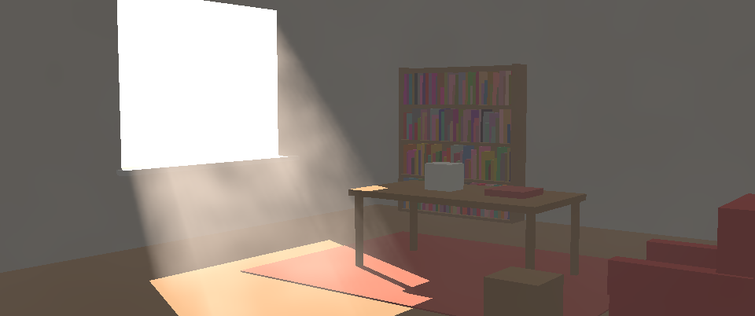
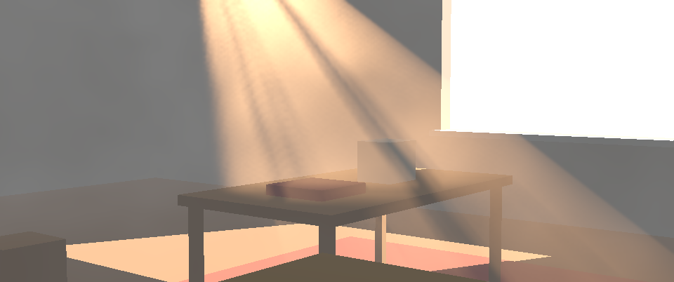
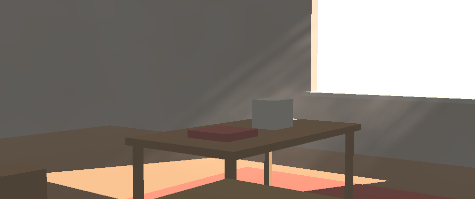
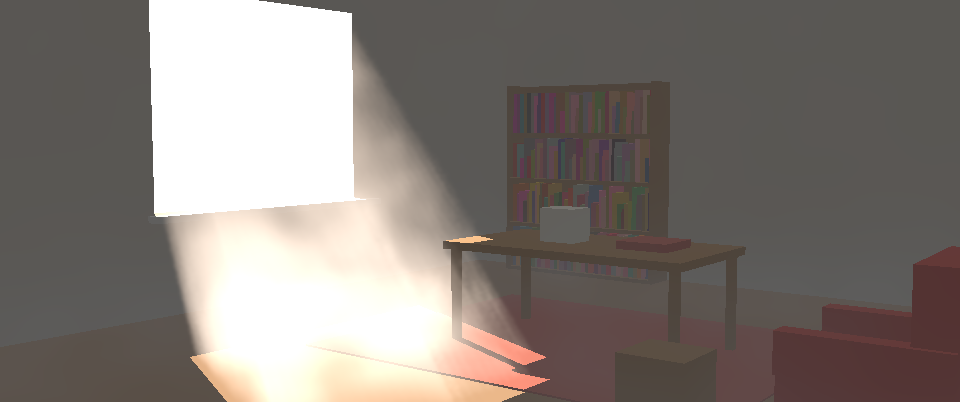
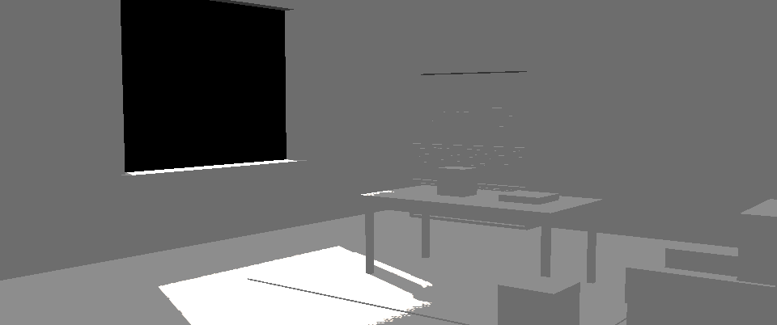

# RayField

RayField adds light shafts (godrays) and haze to a CG shot in comp, from the shot's utility pass. Geometry blocks the
shafts, so they sit at the right depth in front of and behind the set. A cuc (gobo) is any image you plug in, and
the node projects it through the light the way a cookie works on a real light.

**In Nuke 15 it is one node, and nothing gets installed.** Paste or drag [`dist/RayField.nk`](dist/RayField.nk) into
a script, connect the utility pass Read, and view it. The output is an ordinary image to plus (or over) onto the comp.
It writes no files and works in plain Nuke as well as NukeX. See [docs/NUKE.md](docs/NUKE.md).



| | |
|---|---|
|  |  |
| A spot with a window-frame cuc | The sun through a blinds cuc |
|  |  |
| Ground fog, comped with *over* | *View: light on set*, for aiming |

All pictures are of the built-in stand-in room, rendered by the node's own kernels (run as C++ by the test rig).

**Status: phase 1 of 7, the core node.** Sun and spot lights, haze, ground fog, breakup, the cuc input, shadows from
the pass, holdouts against the unfiltered depth, plus/over output, and viewer and render quality settings. Two
things are brought forward from phase 2: the *Lands here* handle and the *Light on set* view. The kernels are tested
against a Python reference, the shadows against the stand-in room's exact geometry, and the node's script and
embedded Python against a stand-in for Nuke. **It has not run in Nuke yet:** see the checklist in
[docs/NUKE.md](docs/NUKE.md#first-time-in-nuke-what-to-check).

## How it works

1. **The light's view of the set.** Using the pass, the node builds a light map: for each direction out of the light,
   how far light travels before something blocks it. A step along the light's path that lands just behind a surface
   the camera sees (by less than *Thickness*) counts as blocked. *Light only through openings* is for rooms: there,
   light only counts as getting in once its path has been outside a window or other opening the camera sees.
2. **The cuc** lives in the same light-space frame as the light map. For a spot it fills the cone; for the sun it is
   *Cuc size* metres wide, centred on the aim point.
3. **The march.** For each pixel the node steps from the camera to the surface (or, where it sees sky, to where its
   ray leaves the set). At each step it takes the haze's density (even haze, ground fog and 3D breakup noise) and the
   light reaching that point (shadow, cuc, cone, falloff, fade). It adds what scatters toward the camera, using a
   forward-scattering glow, plus a little ambient haze. Haze in front dims both.
4. **Back to full resolution**, the march's picture is blended with weights that keep the set's depth edges.

## Layout

```
dist/RayField.nk        the node: paste or drag into Nuke 15 (built by node/build_node.py; don't edit by hand)
node/
  kernels/*.blink       the BlinkScript kernels (shared code in lib_*.blink)
  blinklib.py           puts the kernels together: includes, the shared param table, constants
  nodepy.py             the Python inside the node: wiring, links, layers, the camera from the header, aim, check
  build_node.py         builds dist/RayField.nk: knobs from the settings table, the internal graph, the kernels
  nk.py                 quoting for .nk text
rayfield/               the Python reference: the same maths in numpy, to test the kernels against
  schema.py             every setting, in one table (labels, help, defaults, ranges for the node's knobs)
  lightmath.py          the light: direction, frame, colour temperature, scattering
  reference.py          the renderer, stage by stage as the kernels do it
  standin.py            the built-in stand-in room with a window (synthetic, for tests and pictures)
  camera.py, surface.py, rng.py    reading the camera, the surface image, the integer hash (from MoteField)
tests/
  blink/                a stand-in for Blink: compiles the kernels as C++ and runs them (needs g++)
  nkload.py             reads .nk text the way Nuke does, into stand-in nodes, to test the node without Nuke
  test_kernels.py       kernels against the reference; shadows against exact geometry; behaviour
  test_node.py          the node: quoting, wiring, links, layers, camera, aim, cuc, check
tools/pictures.py       renders the stand-in pictures in docs/img
docs/NUKE.md            using the node in Nuke 15
docs/SETTINGS.md        every setting (generated)
```

## The rules the code keeps

- **One paste-in node.** The kernels are embedded in the script (plain Nuke runs them but can't edit them), and the
  Python lives in a hidden knob and runs from memory. Inside the node there are only plain-Nuke nodes: BlinkScript,
  Shuffle, Crop, Reformat, Blur, Merge, Switch, Multiply and Constant.
- **Nothing written to disk.** Nuke's own caching applies. Each stage is its own node inside the group, so changing
  the haze re-runs only the march, and moving the light re-runs the light map too.
- **Same result everywhere.** The breakup noise and the march's start offsets come from an integer hash (done in
  16-bit halves, as in MoteField), with no state from frame to frame. Any frame renders alone, in any order.
- **One table.** `rayfield/schema.py` holds every setting. The knobs and docs are made from it, and so are the
  reference's defaults.

## Commands

```
python3 node/build_node.py        rebuild dist/RayField.nk (after changing kernels, nodepy.py or the schema)
python3 -m rayfield.schema        regenerate docs/SETTINGS.md
python3 -m pytest tests           all tests (the kernel tests need g++)
python3 tools/pictures.py out     render the stand-in looks to out/
```

## Next

2. **Placing:** a *Comes from* handle (drag onto the window), *Distance* and *Pool size* that keep the aim,
   and a light input that follows a light pasted from Houdini.
3. **USD geometry:** an optional geo input (ReadGeo or GeoImport) rendered from the light, for shadows from things the
   camera can't see (windows above the frame, walls behind the camera).
4. **Cuc:** presets (window, blinds, leaves), painting the cuc on the shot itself, softness.
5. **Matched edges:** holdouts mixed the way the plate's own edges are, using filtered depth and coverage, plus an
   *Edge check* view.
6. **Lens:** depth of field and motion blur from the header's lens and shutter.
7. **Polish:** defaults, speed, an artist quick start and a TD guide.
